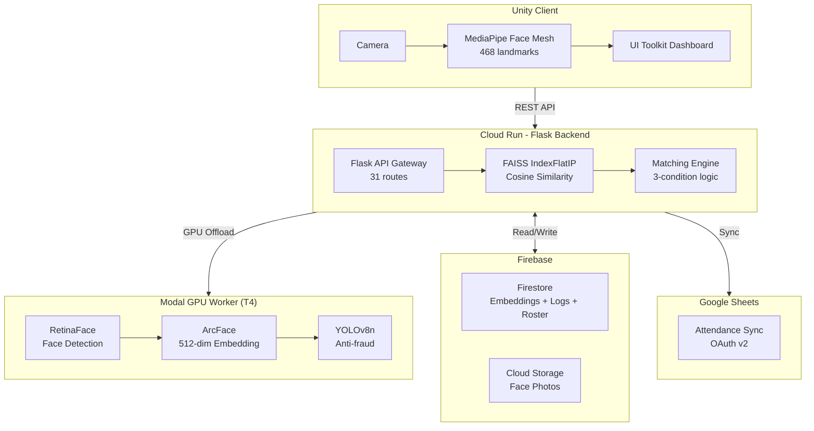
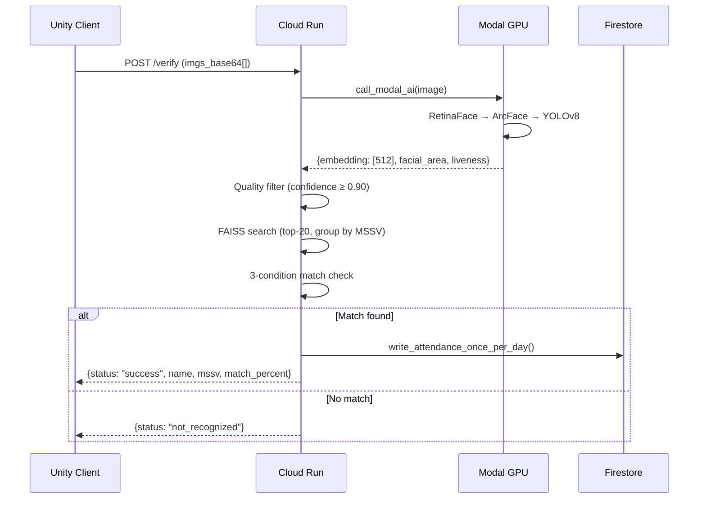

# Kiến trúc hệ thống FaceCheckin AI

## Tổng quan

Hệ thống điểm danh tự động bằng nhận diện khuôn mặt cho lớp học. Giáo viên đăng ký khuôn mặt sinh viên, hệ thống tự động nhận diện và ghi nhận điểm danh khi sinh viên xuất hiện trước camera.

## Kiến trúc 3 tầng (REST API)



## Luồng xử lý chính: `/verify`



## Module Structure (sau refactoring)

```
FaceCheckin_AI/
├── main.py              # Entry point (~50 dòng) — register blueprints, warmup
├── config/
│   ├── __init__.py
│   └── settings.py      # ENV vars, Firebase init, Flask app, global state
├── core/
│   ├── __init__.py
│   ├── modal_client.py  # call_modal_ai() — giao tiếp Modal GPU
│   ├── multitenancy.py  # Multi-tenant helpers (teacher/term/class)
│   ├── helpers.py       # Shared utilities (normalize, auth, attendance)
│   └── faiss_engine.py  # FAISS index load/search, auto-learn
├── api/
│   ├── __init__.py
│   ├── auth.py          # 5 routes: register, login, password mgmt
│   ├── verify.py        # 1 route: /verify (core pipeline)
│   ├── register.py      # 3 routes: /register, /reload, /version
│   ├── profiles.py      # 7 routes: profiles, avatar, correct, delete, logs
│   ├── roster.py        # 4 routes: roster CRUD, schedule bundle
│   └── gsheets.py       # 11 routes: Google OAuth + Sheets v2 + backfill
```

## Face Matching Logic (3 điều kiện)

| Điều kiện | Giá trị | Ý nghĩa |
|-----------|---------|---------|
| `best_sim ≥ COSINE_MIN` | ≥ 0.55 | Ngưỡng tối thiểu |
| `gap ≥ COSINE_GAP_MIN` | ≥ 0.03 | Top-1 phải vượt top-2 |
| `ratio ≤ COSINE_RATIO_MAX` | ≤ 0.97 | Top-2 không quá gần top-1 |

> Kết quả được nhóm theo MSSV để tránh top-1 và top-2 cùng 1 người.

## Multi-Tenancy

Mỗi request API dùng headers `X-Teacher-ID`, `X-Term-ID`, `X-Class-ID` để phân vùng dữ liệu.

```
Firestore path: Teachers/{teacher_id}/terms/{term_id}/classes/{class_id}/
  ├── FaceVectors/    # Embedding vectors
  ├── attendance_logs/ # Điểm danh
  ├── roster/          # Danh sách sinh viên
  └── gsheets/         # Google Sheets metadata
```
